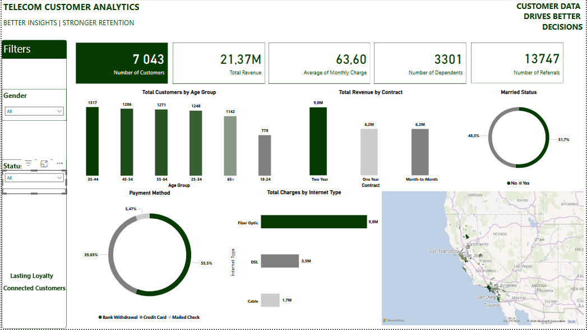
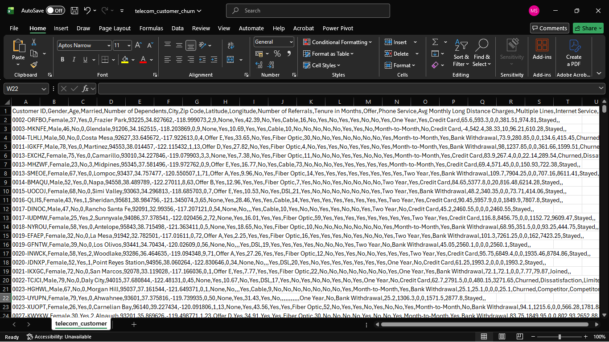
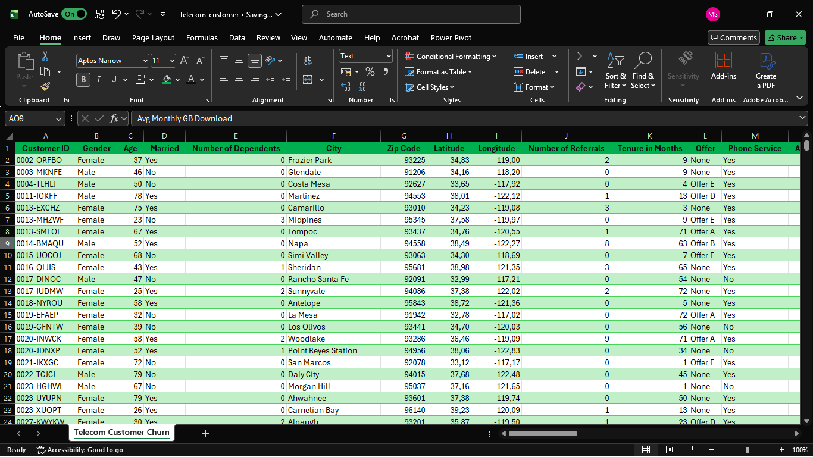
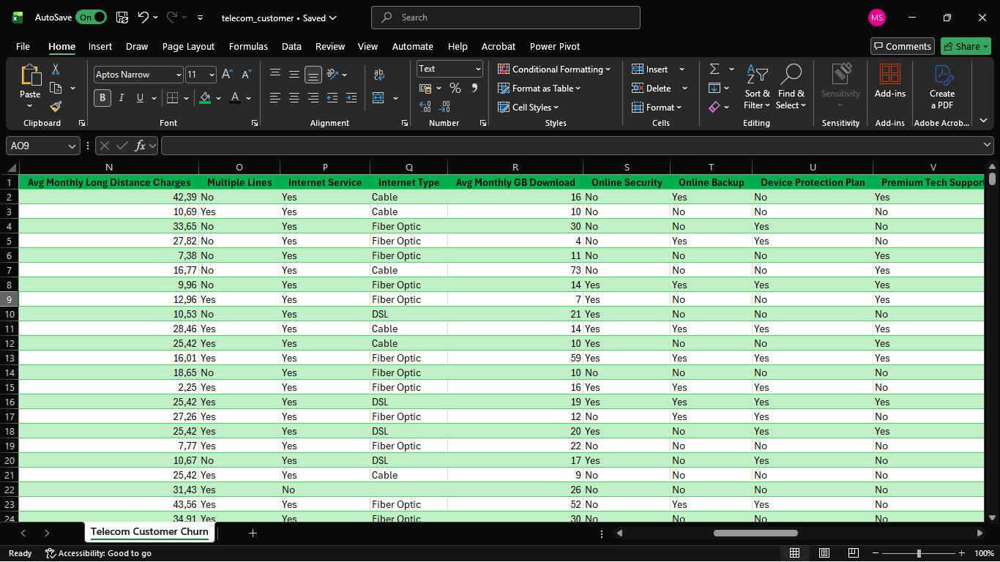
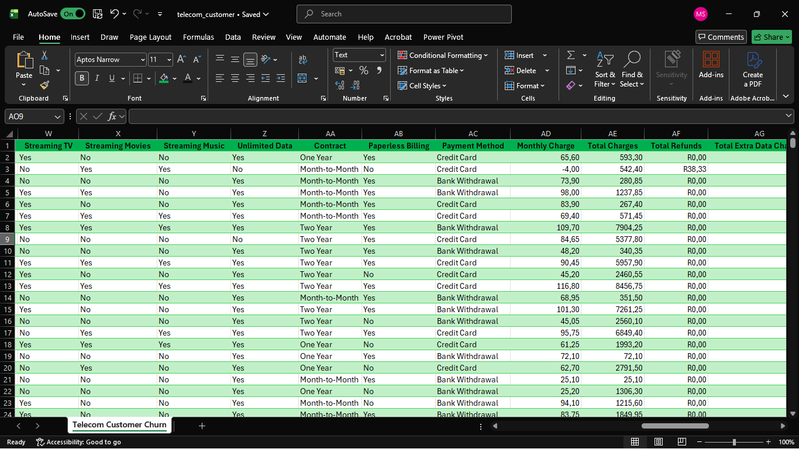
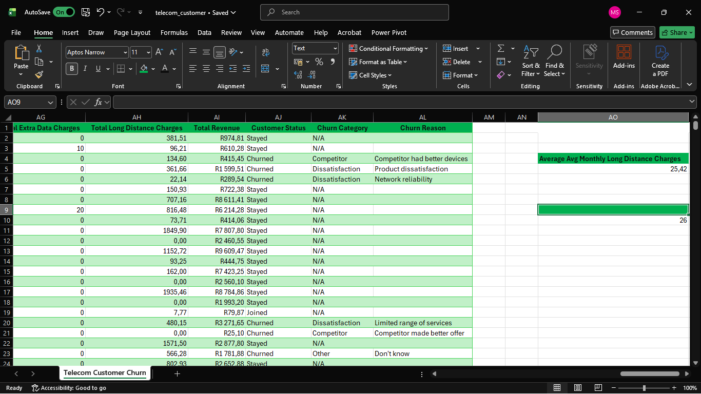

# Telecom Customer Analytics Dashboard — Power BI

## Overview
An end-to-end Power BI project analysing a telecom company's customer base of **7,043 customers**. The report profiles who the customers are, which contracts and internet services generate the most revenue, how customers pay, and where they are located, to support data-driven decisions on marketing, pricing and service offerings.

## Dashboard








## Business Questions Addressed
- How large is the customer base, and what does it generate in total revenue and average monthly charge?
- What does the customer base look like by age group, gender and marital status?
- Which contract types contribute the most revenue?
- Which internet services (Fiber Optic, DSL, Cable) drive the most charges?
- How do customers prefer to pay?
- Where are customers geographically concentrated?

## Data Model
Built on a single flat table (`Table1`) with one row per customer (7,043 rows), which is sufficient for this scope of customer profiling.

**Fields used on the dashboard**
- **Customer:** Customer ID, Gender, Age (grouped into Age Group), Married, Number of Dependents, Number of Referrals, Customer Status
- **Service and billing:** Contract, Internet Type, Payment Method, Monthly Charge, Total Charges, Total Revenue
- **Location:** City, Latitude, Longitude

## Data Profiling
Before building any visuals, I profiled the dataset to understand its quality and structure.

- **No duplicates.** There are no duplicate rows and no duplicate Customer IDs. Category labels are consistent, and there are no disguised nulls.
- **Customer Status has three values, not two:** Stayed (4,720), Churned (1,869) and Joined (454). These add up to the full 7,043 customers.
- **The nulls are structural, not errors.** Each blank block lines up exactly with another field:
  - Internet Type, Avg Monthly GB Download and the internet add-on columns (1,526 blanks each) are blank only where Internet Service = No.
  - Multiple Lines and Avg Monthly Long Distance Charges (682 each) are blank only where Phone Service = No.
  - Offer (3,877 blanks) means the customer had no offer.
- **120 rows have a negative monthly charge**, ranging from -1 to -10. A negative monthly charge is not valid and could be a credit or a data-entry error.
- **Total Revenue reconciles** with Total Charges − Total Refunds + Total Extra Data Charges + Total Long Distance Charges, with zero mismatches, so the revenue figures on the dashboard can be trusted.

## Data Challenges and Decisions
- **Structural nulls.** Blanks in Internet Type, Multiple Lines and Offer mean "not applicable", not "missing". *Decision:* do not drop or impute them. Recode them to meaningful labels such as "No Internet Service", "No Phone Service" and "No Offer", because deleting or filling them would distort the data. *Effect on the dashboard:* the Internet Type chart shows the three internet types, so the 1,526 customers without internet service are not part of it. This is one reason its total (about 15.0M) differs from Total Revenue (21.37M). The other is that Total Revenue also includes extra data and long distance charges, less refunds.
- **Negative Monthly Charge (120 rows).** These values are not valid, so they affect the Average Monthly Charge KPI (63.60). *Decision:* [flag, correct or exclude, and note why].
- **Customer Status values.** Status has three values (Stayed, Churned, Joined). *Decision:* the KPIs and charts cover all 7,043 customers by default, and the Customer Status slicer lets users view any one group on its own.
- **Latitude and Longitude formatting.** Power BI displayed them as currency (for example "R34,1824"), which would break the map. *Fix:* change the column format to a plain decimal number with no currency symbol.
- **Age groups.** The source has a raw Age field, which is too granular to chart. *Decision:* group it into age bands (18-24 up to 65+) with a calculated column (see DAX below).

## Process
1. **Profiling:** Checked duplicates, null patterns, value ranges and reconciliation of revenue fields.
2. **Preparation:** Applied the decisions above in Power Query, and created the Age Group column.
3. **Measures:** Defined the KPI aggregations and a customer-count measure used across the charts.
4. **Visualisation:** Built KPI cards, column, donut and bar charts, and a filled map of customer locations.
5. **Interactivity:** Added Gender and Customer Status slicers that filter every visual on the page.
6. **Design:** Applied a consistent green and grey palette so the dashboard reads as one cohesive report.

## DAX

**Age Group (calculated column).** `SWITCH(TRUE(), ...)` tests the conditions from top to bottom and returns the first one that is true, so each line only needs an upper limit. The labels sort correctly in a chart because they are already in alphabetical order.

```dax
Age Group =
SWITCH(
    TRUE(),
    Table1[Age] < 25, "18-24",
    Table1[Age] < 35, "25-34",
    Table1[Age] < 45, "35-44",
    Table1[Age] < 55, "45-54",
    Table1[Age] < 65, "55-64",
    "65+"
)
```

**Total Customers (measure).** Counts the customer rows in the current filter.

```dax
Total Customers = COUNTROWS(Table1)
```

**KPI cards**

| KPI | Aggregation |
|---|---|
| Number of Customers | Distinct count of Customer ID |
| Total Revenue | Sum of Total Revenue |
| Average Monthly Charge | Average of Monthly Charge |
| Number of Dependents | Sum of Number of Dependents |
| Number of Referrals | Sum of Number of Referrals |

Customers are counted with a distinct count of Customer ID, which is safe because profiling confirmed there are no duplicate IDs.

## Key Insights
- **Customer base:** 7,043 customers generate **21.37M** in total revenue, about 3,030 per customer, with an average monthly charge of **63.60**.
- **Age:** customers aged 25-64 make up about **73%** of the base, with a balanced spread across those four bands (1,248 to 1,317 customers each). Ages 18-24 are the smallest group (779, about 11%).
- **Contracts:** two-year contracts generate the most revenue (**9.0M, about 42%**). One-year and month-to-month contracts contribute equally (6.2M each, about 29%).
- **Internet type:** Fiber Optic is the main driver at **9.8M**, about two-thirds of internet charges. DSL (3.5M) and Cable (1.7M) trail well behind.
- **Payment:** most customers pay by bank withdrawal (**55.5%**), followed by credit card (39.0%). Mailed cheque is rare (5.5%).
- **Households:** the base is split almost evenly between married (48.3%) and unmarried (51.7%) customers.
- **Geography:** customers are concentrated in California's major metro areas, especially around Los Angeles and the Bay Area.
- **Referrals:** the base averages about 2 referrals per customer (13,747 in total), which suggests word of mouth is working.

## Recommendations
- **Protect Fiber Optic.** It generates about two-thirds of internet charges, so service quality and pricing on this product matter most to revenue.
- **Look closer at contract mix before pushing upgrades.** Two-year contracts earn the most revenue, but the chart shows revenue, not customer counts. Add customer count and revenue per customer by contract to confirm whether moving customers to longer contracts would pay off.
- **Target the 18-24 segment.** It is the smallest age group (about 11% of customers), which points to an opportunity for youth-focused plans or acquisition campaigns.
- **Formalise referrals.** With about 2 referrals per customer already, a structured referral reward programme could build on a channel that is working.
- **Focus on the main metro areas, and test elsewhere.** Customers cluster around Los Angeles and the Bay Area, so service and marketing effort there protects the core, while smaller cities may hold untapped demand.
- **Review the negative monthly charges.** Ask the billing team whether the 120 rows are credits or entry errors, so the Average Monthly Charge KPI can be trusted.

## Design Decisions and Limitations
- **Customer analysis, not churn analysis.** The dashboard is scoped to understanding the customer base and revenue. It does not report churn rates, so it makes no claims about why customers leave.
- **Revenue is not customer count.** The contract chart shows total revenue, so it shows which contracts earn the most, not which have the most customers or the highest spend per customer.
- **Single-table model.** A larger project would split this into fact and dimension tables.
- Findings describe this dataset only and should not be generalised to other telecom companies.

## Tools Used
Power BI Desktop (Power Query, DAX, visualisation, slicers, map visual)

## Notes on Data
This is a portfolio project focused on customer profiling and revenue analysis in a telecom setting. Source: [add dataset link here]

## Author
**Sello Mpho** · Bloemfontein, South Africa
[Portfolio](https://mpho-sello.vercel.app/) · [LinkedIn](https://www.linkedin.com/in/mpho-sello-692193241) · sellompho1601@gmail.com
